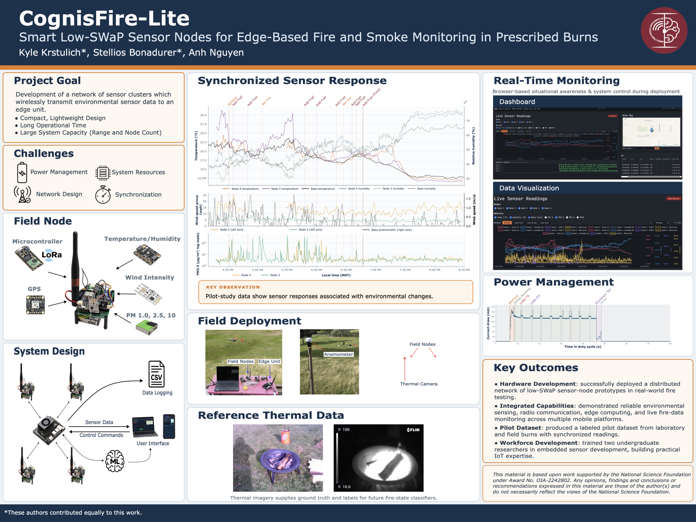

# SmartFires IoT

SmartFires is an edge-based wildfire telemetry platform for prescribed-burn
monitoring. Distributed Feather M0 RFM95 nodes collect environmental and motion
data, transmit compact binary packets over a custom 915 MHz LoRa/TDMA network,
and stream through a Feather base station to a Jetson Orin Nano. The Jetson
records each session and serves a live, offline-capable dashboard.

[](assets/poster/SmartFires_poster.pdf)

Click the poster preview to open the full-resolution 48 × 36 inch PDF.

## System overview

```text
Feather M0 sensor nodes
  SHT31 · wind · PA1010D GPS · SPS30 · ICM-20948
                         │
                         │  LoRa 915 MHz · binary packets · TDMA
                         ▼
Feather M0 RFM95 base station
                         │
                         │  USB CDC · 115200 baud
                         ▼
Jetson Orin Nano
  Python ingest · durable session files · FastAPI dashboard
```

The firmware provides runtime node assignment, profile-based TDMA scheduling,
application-layer retransmission, duty cycling, watchdog recovery, reset
coordination, and adaptive node transmit power. The edge service decodes the
wire protocol, correlates persistent node identities, records telemetry, and
exposes live maps, charts, logs, and radio diagnostics.

## Repository layout

| Path | Purpose |
|---|---|
| [`platformio/`](platformio/) | Feather node, base-station, sniffer, and power-test firmware plus native Unity tests |
| [`edge/`](edge/) | Installable Jetson receiver, web dashboard, systemd unit, and deployment helpers |
| [`documentation/`](documentation/) | Current architecture and operator documentation |
| [`tools/`](tools/) | Reusable diagnostics, plotting, synchronization, and deployment utilities |
| [`wind_test_bench/`](wind_test_bench/) | Standalone wind-sensor bench firmware |
| [`assets/poster/`](assets/poster/) | Final project poster and GitHub preview |

Raw field recordings, generated plots, screenshots, poster working files, and
historical planning notes are intentionally kept outside the Git repository.

## Documentation

- [Software design](documentation/SOFTWARE_DESIGN.md)
- [Architecture diagrams](documentation/SOFTWARE_DESIGN_DIAGRAM.md)
- [TDMA protocol](documentation/Current_Architecture/TDMA_PROTOCOL.md)
- [Packet reliability](documentation/Current_Architecture/PACKET_RELIABILITY.md)
- [Jetson bridge and dashboard](documentation/Current_Architecture/JETSON_BRIDGE.md)
- [Firmware workflow](platformio/README.md)
- [Edge receiver setup](edge/edge-receiver/README.md)
- [Complete documentation index](documentation/README.md)

## Quick start

Install and run the Jetson service from the repository root:

```bash
python3 -m pip install --use-pep517 -e edge/edge-receiver
smartfires-edge web --port /dev/smartfires-base --http-port 8080
```

Firmware targets and build commands are documented in
[`platformio/README.md`](platformio/README.md). Hardware upload and serial
monitor commands require the intended Feather board to be connected.

## Validation

Safe host-side checks include:

```bash
python3 documentation/check_doc_freshness.py
python3 documentation/check_code_headers.py
python3 -m compileall -q edge/edge-receiver/src
```

The native firmware test suite and its currently known failures are documented
in [`platformio/test/README`](platformio/test/README).

## License

No license file is currently present. Add one before redistributing the project
outside the team.
